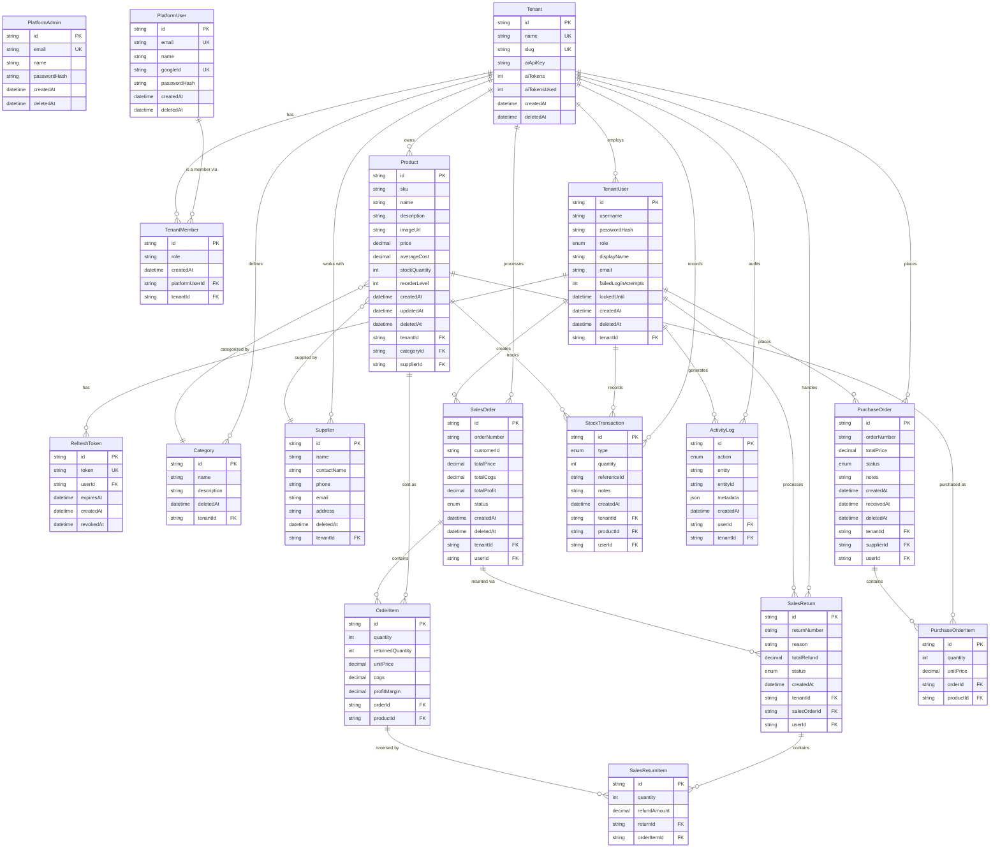
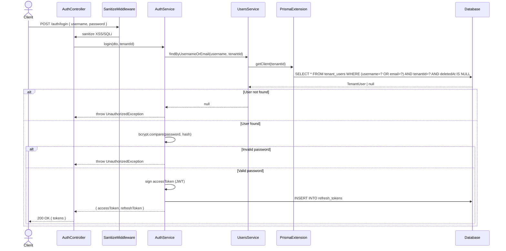
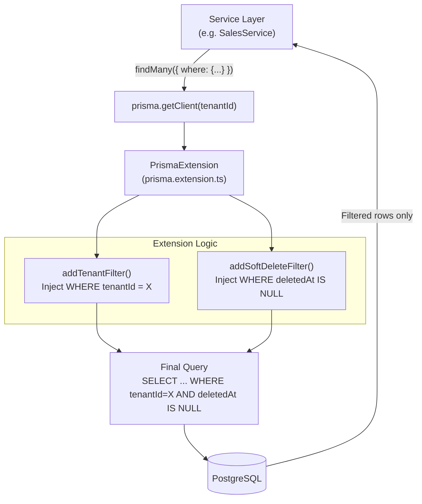
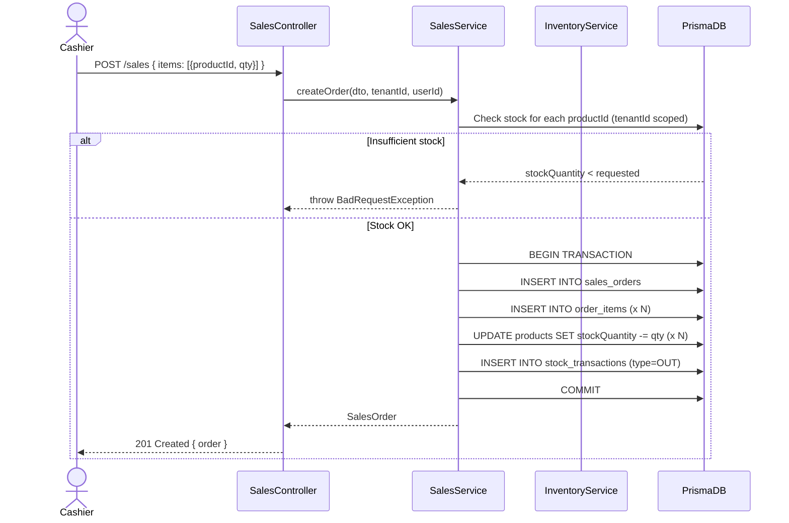
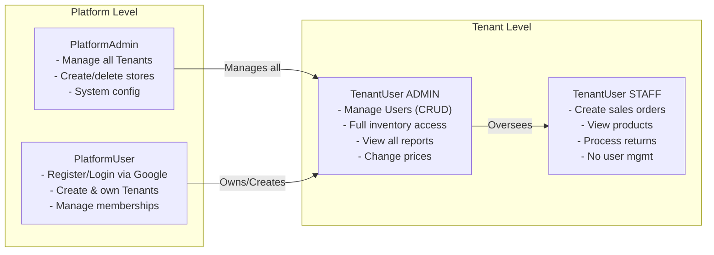

# CrackPOS — Complete System Documentation & Diagrams

---

## 1. Entity Relationship Diagram (ERD) — Lengkap

### Mermaid Format (Visual)



### DBDiagram.io Format (Copy-Paste Ready)

Gunakan format di bawah ini untuk membuat ERD di [dbdiagram.io](https://dbdiagram.io):

```sql
// Platform Level
Table platform_admins {
  id string [pk]
  email string [unique, not null]
  name string
  passwordHash string [not null]
  createdAt timestamp [default: `now()`]
  deletedAt timestamp
}

Table platform_users {
  id string [pk]
  email string [unique, not null]
  name string
  googleId string [unique]
  passwordHash string
  createdAt timestamp [default: `now()`]
  deletedAt timestamp
}

// Tenant & Multi-Tenancy
Table tenants {
  id string [pk]
  name string [unique, not null]
  slug string [unique, not null]
  aiApiKey string
  aiTokens int [default: 0]
  aiTokensUsed int [default: 0]
  createdAt timestamp [default: `now()`]
  deletedAt timestamp
}

Table tenant_members {
  id string [pk]
  platformUserId string [not null]
  tenantId string [not null]
  role string [default: 'OWNER']
  createdAt timestamp [default: `now()`]
}

Ref: tenant_members.platformUserId > platform_users.id
Ref: tenant_members.tenantId > tenants.id

Table tenant_users {
  id string [pk]
  tenantId string [not null]
  username string [not null]
  passwordHash string [not null]
  role string [default: 'STAFF']
  displayName string
  email string
  failedLoginAttempts int [default: 0]
  lockedUntil timestamp
  createdAt timestamp [default: `now()`]
  deletedAt timestamp
}

Ref: tenant_users.tenantId > tenants.id

Table refresh_tokens {
  id string [pk]
  token string [unique, not null]
  userId string [not null]
  expiresAt timestamp [not null]
  createdAt timestamp [default: `now()`]
  revokedAt timestamp
}

Ref: refresh_tokens.userId > tenant_users.id

// Catalog
Table categories {
  id string [pk]
  tenantId string [not null]
  name string [not null]
  description text
  deletedAt timestamp
}

Ref: categories.tenantId > tenants.id

Table suppliers {
  id string [pk]
  tenantId string [not null]
  name string [not null]
  contactName string
  phone string
  email string
  address text
  deletedAt timestamp
}

Ref: suppliers.tenantId > tenants.id

Table products {
  id string [pk]
  tenantId string [not null]
  categoryId string
  supplierId string
  sku string [not null]
  name string [not null]
  description text
  imageUrl string
  price decimal(12,2) [not null]
  averageCost decimal(12,2) [default: 0]
  stockQuantity int [default: 0]
  reorderLevel int [default: 10]
  createdAt timestamp [default: `now()`]
  updatedAt timestamp
  deletedAt timestamp
}

Ref: products.tenantId > tenants.id
Ref: products.categoryId > categories.id
Ref: products.supplierId > suppliers.id

// Inventory
Table stock_transactions {
  id string [pk]
  tenantId string [not null]
  productId string [not null]
  userId string [not null]
  type string [not null]
  quantity int [not null]
  referenceId string
  notes text
  createdAt timestamp [default: `now()`]
}

Ref: stock_transactions.tenantId > tenants.id
Ref: stock_transactions.productId > products.id
Ref: stock_transactions.userId > tenant_users.id

// Sales
Table sales_orders {
  id string [pk]
  tenantId string [not null]
  userId string [not null]
  orderNumber string [not null]
  customerId string
  totalPrice decimal(12,2) [not null]
  totalCogs decimal(12,2) [default: 0]
  totalProfit decimal(12,2) [default: 0]
  status string [default: 'PENDING']
  createdAt timestamp [default: `now()`]
  deletedAt timestamp
}

Ref: sales_orders.tenantId > tenants.id
Ref: sales_orders.userId > tenant_users.id

Table order_items {
  id string [pk]
  orderId string [not null]
  productId string [not null]
  quantity int [not null]
  returnedQuantity int [default: 0]
  unitPrice decimal(12,2) [not null]
  cogs decimal(12,2) [default: 0]
  profitMargin decimal(12,2) [default: 0]
}

Ref: order_items.orderId > sales_orders.id
Ref: order_items.productId > products.id

Table sales_returns {
  id string [pk]
  tenantId string [not null]
  salesOrderId string [not null]
  userId string [not null]
  returnNumber string [not null]
  reason text
  totalRefund decimal(12,2) [default: 0]
  status string [default: 'PENDING']
  createdAt timestamp [default: `now()`]
}

Ref: sales_returns.tenantId > tenants.id
Ref: sales_returns.salesOrderId > sales_orders.id
Ref: sales_returns.userId > tenant_users.id

Table sales_return_items {
  id string [pk]
  returnId string [not null]
  orderItemId string [not null]
  quantity int [not null]
  refundAmount decimal(12,2) [not null]
}

Ref: sales_return_items.returnId > sales_returns.id
Ref: sales_return_items.orderItemId > order_items.id

// Purchase
Table purchase_orders {
  id string [pk]
  tenantId string [not null]
  supplierId string [not null]
  userId string [not null]
  orderNumber string [not null]
  totalPrice decimal(12,2) [not null]
  status string [default: 'PENDING']
  notes text
  createdAt timestamp [default: `now()`]
  receivedAt timestamp
  deletedAt timestamp
}

Ref: purchase_orders.tenantId > tenants.id
Ref: purchase_orders.supplierId > suppliers.id
Ref: purchase_orders.userId > tenant_users.id

Table purchase_order_items {
  id string [pk]
  orderId string [not null]
  productId string [not null]
  quantity int [not null]
  unitPrice decimal(12,2) [not null]
}

Ref: purchase_order_items.orderId > purchase_orders.id
Ref: purchase_order_items.productId > products.id

// Audit
Table activity_logs {
  id string [pk]
  tenantId string [not null]
  userId string [not null]
  action string [not null]
  entity string [not null]
  entityId string
  metadata json
  createdAt timestamp [default: `now()`]
}

Ref: activity_logs.tenantId > tenants.id
Ref: activity_logs.userId > tenant_users.id
```

---

## 2. Application Architecture — Module Diagram

```mermaid
graph TB
    subgraph "Entry Point"
        Main["main.ts\n(Bootstrap, CORS, Swagger,\nHelmet, Throttling, Validation)"]
    end

    subgraph "App Module"
        AppMod["AppModule"]
    end

    subgraph "Core Infrastructure"
        PrismaMod["PrismaModule\n(Global)"]
        PrismaSvc["PrismaService"]
        PrismaExt["prisma.extension.ts\n(Tenant Filter +\nSoft Delete)"]
        PrismaSvc --> PrismaExt
    end

    subgraph "Auth & Users"
        AuthMod["AuthModule"]
        AuthCtrl["AuthController"]
        AuthSvc["AuthService\n(JWT, Bcrypt, Tokens)"]
        UsersMod["UsersModule"]
        UsersCtrl["UsersController"]
        UsersSvc["UsersService"]

        AuthCtrl --> AuthSvc
        AuthSvc --> UsersSvc
    end

    subgraph "Platform Admin"
        AdminMod["AdminModule"]
        AdminCtrl["AdminController"]
        AdminSvc["AdminService"]
        AdminCtrl --> AdminSvc
    end

    subgraph "Business Logic"
        SalesMod["SalesModule"]
        SalesCtrl["SalesController"]
        SalesSvc["SalesService"]
        SalesCtrl --> SalesSvc

        PurchaseMod["PurchaseModule"]
        PurchaseCtrl["PurchaseController"]
        PurchaseSvc["PurchaseService"]
        PurchaseCtrl --> PurchaseSvc

        ReturnsMod["ReturnsModule"]
        ReturnsCtrl["ReturnsController"]
        ReturnsSvc["ReturnsService"]
        ReturnsCtrl --> ReturnsSvc

        InventoryMod["InventoryModule"]
        InventoryCtrl["InventoryController"]
        InventorySvc["InventoryService"]
        InventoryCtrl --> InventorySvc
    end

    subgraph "Catalog"
        ProductsMod["ProductsModule"]
        ProductsCtrl["ProductsController"]
        ProductsSvc["ProductsService"]
        ProductsCtrl --> ProductsSvc

        CatMod["CategoriesModule"]
        CatCtrl["CategoriesController"]
        CatSvc["CategoriesService"]
        CatCtrl --> CatSvc

        SuppMod["SuppliersModule"]
        SuppCtrl["SuppliersController"]
        SuppSvc["SuppliersService"]
        SuppCtrl --> SuppSvc
    end

    subgraph "AI & Data"
        AIMod["AIModule"]
        AICtrl["AIController"]
        AISvc["AIService\n(Python AI Proxy)"]
        AICtrl --> AISvc

        AIDataMod["AIDataModule"]
        AIDataCtrl["AIDataController"]
    end

    subgraph "Observability"
        DashMod["DashboardModule"]
        DashCtrl["DashboardController"]
        DashSvc["DashboardService"]
        DashCtrl --> DashSvc

        LogMod["ActivityLogModule"]
        LogCtrl["ActivityLogController"]

        HealthMod["HealthModule"]
        HealthCtrl["HealthController"]
    end

    subgraph "Common (Shared)"
        Guards["Guards\n(JwtAuth, PlatformJwt,\nTenantThrottler, CSRF)"]
        Filters["Filters\n(AllExceptions,\nPrismaClientException)"]
        Interceptors["Interceptors\n(AuditLog, Cache)"]
        Middleware["Middleware\n(SanitizeMiddleware)"]
        Decorators["Decorators\n(CurrentUser,\nRoles, Tenant)"]
    end

    Main --> AppMod
    AppMod --> PrismaMod
    AppMod --> AuthMod & UsersMod & AdminMod
    AppMod --> SalesMod & PurchaseMod & ReturnsMod & InventoryMod
    AppMod --> ProductsMod & CatMod & SuppMod
    AppMod --> AIMod & AIDataMod
    AppMod --> DashMod & LogMod & HealthMod

    PrismaSvc --> SalesSvc & PurchaseSvc & ReturnsSvc
    PrismaSvc --> ProductsSvc & CatSvc & SuppSvc
    PrismaSvc --> InventorySvc & UsersSvc & AdminSvc
    PrismaSvc --> AISvc & DashSvc
```



---

## 3. Login & Authentication Flow



---

## 4. Multi-Tenant Prisma Extension Flow



---

## 5. Stock & Inventory Flow



---

## 6. User Roles & Permission Matrix



---

## 7. Enum Reference

| Enum | Values |
|:---|:---|
| `TenantRole` | `ADMIN`, `STAFF` |
| `TransactionType` | `IN`, `OUT`, `ADJUSTMENT`, `RETURN` |
| `PurchaseOrderStatus` | `PENDING`, `RECEIVED`, `CANCELLED` |
| `SalesOrderStatus` | `PENDING`, `COMPLETED`, `CANCELLED` |
| `ReturnStatus` | `PENDING`, `COMPLETED`, `REJECTED` |
| `ActivityAction` | `CREATE`, `UPDATE`, `DELETE`, `LOGIN`, `LOGOUT` |
